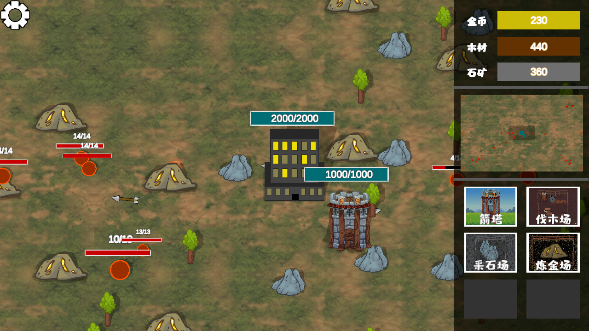

这是我之前用 Unity 做的一个塔防小游戏。选择建筑、收集资源，再用箭塔应对不断到来的敌人。现在把它搬到了这个网站，可以直接在浏览器里试玩。

```{=html}
<section class="game-player" aria-label="Tower Defense 在线试玩" data-game-player data-game-src="game/index.html">
  <div class="game-player__stage" data-game-stage>
    <div class="game-player__poster" data-game-poster>
      
      <div class="game-player__intro">
        <span class="game-player__eyebrow">TOWER DEFENSE</span>
        <p>守住下一波。</p>
        <button class="game-player__start" type="button" data-game-start>开始试玩</button>
      </div>
    </div>
  </div>
  <div class="game-player__toolbar">
    <p class="game-player__status" role="status" aria-live="polite" data-game-status>点击开始后加载游戏，首次加载需要一点时间。</p>
    <button class="game-player__stop" type="button" data-game-stop hidden>结束试玩</button>
  </div>
  <p class="game-player__mobile" data-game-mobile hidden>这个版本需要鼠标操作，请使用电脑浏览器试玩。</p>
</section>
<script src="player.js" defer></script>
```

## 怎么玩

| 操作 | 用途 |
|---|---|
| 左键点击 | 选择建筑；建造完成后选择并放置到地图上 |
| 按住右键拖动 | 移动视角 |
| 滚轮 | 缩放地图 |
| 游戏内设置 | 调整音乐、音效，或返回主菜单 |

建筑需要消耗金币、木材或石材。伐木场、采石场和炼金场提供资源，箭塔负责防守。建造需要一点时间，也要留意建筑的放置位置。

敌人会一波接着一波出现。资源有限，先发展还是先防守，由你决定。

网页版保留了原来的单机玩法，关闭了调试用的账号登录和成绩上传。游戏在你的浏览器中运行；点击“结束试玩”可以关闭画面和声音，再次开始会开启新的一局。
