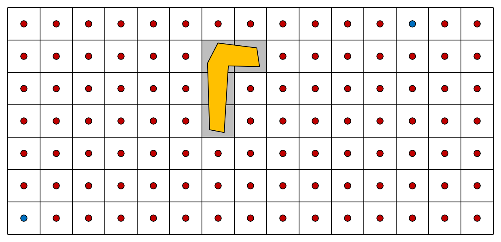
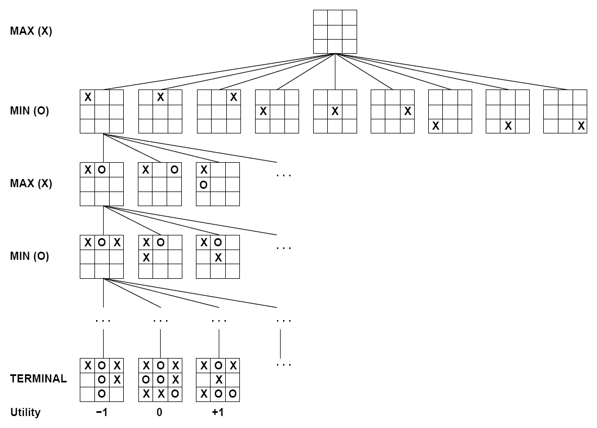
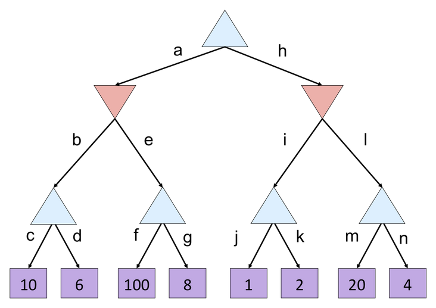

## Single-Agent Search

### Formulation and Search Strategies

- Search problem: State space $S$, start $s_{\mathrm{start}}$, $\operatorname{Actions}(s)$, successor $\operatorname{Succ}(s,a)$, $\operatorname{Cost}(s,a)$, and goal test $\operatorname{IsEnd}(s)$; find a minimum-cost action plan to a goal.
- Fringe priority ($g(n)$: backward path cost; $h(n)$: estimated forward cost to goal):

| Method | Priority | Optimal? | Note |
| :--- | :--- | :--- | :--- |
| UCS | $g(n)$ | Yes ($\text{cost} \ge 0$) | Uniform cost contours ($h=0$) |
| Greedy | $h(n)$ | No | Forward estimate only |
| A\* | $f(n) = g(n) + h(n)$ | Yes (admissible / consistent $h$) | Optimal efficiency among exact methods |

- Goal-test rule: Stop only when a goal is **popped for expansion**, never when first pushed onto the fringe.

### A\* Tree Search vs. Graph Search

::: {#def-ai-1-1 name="Admissible and Consistent Heuristics"}

- Admissible (optimistic): $0 \le h(n) \le h^*(n)$, where $h^*(n)$ is true minimum cost to a goal.
- Consistent (triangle inequality): $h(n) \le \operatorname{cost}(n \to n') + h(n')$ for every arc $n \to n'$.

:::

- A\* tree-search optimality (blocking proof): Let $A$ be an optimal goal and $B$ a suboptimal goal ($f(A) = g(A) < g(B) = f(B)$ since $h=0$ at goals). Any unexpanded fringe ancestor $n$ of $A$ satisfies

  $$
  f(n) = g(n) + h(n) \le g(A) = f(A) < f(B),
  $$

  so $n$—and eventually $A$—is expanded before $B$.
- Graph search: Maintain a **closed set** (hash/tree set) of expanded states to avoid exponential repeated-state work.
- Consistency implies non-decreasing $f$-contours along every arc $n \to n'$:

  $$
  f(n') = g(n) + \operatorname{cost}(n \to n') + h(n') \ge g(n) + h(n) = f(n),
  $$

  guaranteeing A\* graph search pops every state via an optimal path first.
- Relaxed-problem heuristics: For any relaxation $P^j$ with $\operatorname{Cost}^j(s,a) \le \operatorname{Cost}(s,a)$ (e.g., tile-overlapping 8-puzzle $\implies$ Manhattan distance), $h(s) = \operatorname{FutureCost}^j(s)$ is automatically consistent:

  $$
  h(s) \le \operatorname{Cost}^j(s, a) + h\bigl(\operatorname{Succ}(s, a)\bigr) \le \operatorname{Cost}(s, a) + h\bigl(\operatorname{Succ}(s, a)\bigr).
  $$

  If $h_1, h_2$ are consistent, $h(s) = \max\{h_1(s), h_2(s)\}$ is consistent and dominates both.

### Motion Planning Variants

- Cell decomposition: Partition space into free, obstacle, and mixed cells; search free cells and recursively subdivide mixed cells.
- Visibility graph: Connect mutually visible polygonal obstacle vertices ($O(n^2)$ edges, built in $O(n^2)$–$O(n^3)$) for exact Euclidean shortest paths.
- Weighted A\*: Priority $f(s) = g(s) + \varepsilon h(s)$ ($\varepsilon > 1$) yields large speedups with $\varepsilon$-suboptimality ($\operatorname{cost} \le \varepsilon \cdot \operatorname{opt}$).
- **Hybrid A\***: Searches $(x, y, \theta)$ cells using continuous kinematically feasible primitives $s' = F(s, u)$ (steering + forward/reverse).

{.notes-slide-fig width="74%" fig-align="center"}

## Adversarial Search and Game Theory

### Minimax and Alpha-Beta Pruning

- Turn-based game: States $S$, players $P$, actions $A$, transition $S \times A \to S$, terminal test, and utilities (zero-sum: $u_2 = -u_1$; general-sum: independent payoffs). Solution is a policy $\pi: S \to A$.
- Minimax (2-player zero-sum): MAX takes $\max_{s'} V(s')$, MIN takes $\min_{s'} V(s')$; $O(b^m)$ time, $O(bm)$ space.

{.notes-slide-fig width="78%" fig-align="center"}

- Alpha-Beta pruning: Track $\alpha$ (best value MAX can guarantee on path) and $\beta$ (best value MIN can guarantee); prune when $v \ge \beta$ at MAX or $v \le \alpha$ at MIN, preserving exact root value:

```python
def max_value(state, alpha, beta):
    if is_terminal(state): return utility(state)
    v = -inf
    for s in successors(state):
        v = max(v, min_value(s, alpha, beta))
        if v >= beta: return v
        alpha = max(alpha, v)
    return v

def min_value(state, alpha, beta):
    if is_terminal(state): return utility(state)
    v = +inf
    for s in successors(state):
        v = min(v, max_value(s, alpha, beta))
        if v <= alpha: return v
        beta = min(beta, v)
    return v
```

- Move ordering & cutoffs:
  - Perfect ordering cuts time from $O(b^m)$ to $O(b^{m/2})$ (doubles solvable depth).
  - Depth-limited minimax: Pair iterative deepening with a linear feature evaluation $\operatorname{Eval}(s) = \sum_{i=1}^n w_i f_i(s)$ at cutoff leaves.

{.notes-slide-fig width="48%" fig-align="center"}

### Normal-Form Games and Nash Equilibrium

- Strategies: Pure strategy picks one action ($p=1$); mixed strategy randomizes over actions. Player $i$'s best response is $\operatorname{BR}_i(s_{-i}) = \arg\max_{s_i} u_i(s_i, s_{-i})$.

::: {#def-ai-1-2 name="Nash Equilibrium"}

Profile $s^* = (s_1^*, \dots, s_N^*)$ is a Nash equilibrium if $s_i^* \in \operatorname{BR}_i(s_{-i}^*)$ for all $i$:

$$
\forall\,i,\, s_i: \quad u_i(s_i^*, s_{-i}^*) \ge u_i(s_i, s_{-i}^*).
$$

:::

- Computing NE: Check mutual best-response cells, iteratively eliminate strictly dominated strategies, or apply the **indifference principle**—every pure action played with positive probability in a mixed NE yields equal expected payoff (e.g., unique $(\frac13,\frac13,\frac13)$ in Rock–Paper–Scissors).

::: {#thm-ai-1-1 name="Nash Existence & von Neumann Minimax"}

1. Nash (1950): Every finite game (finitely many players and actions) admits at least one pure or mixed Nash equilibrium.
2. von Neumann: In any finite two-player zero-sum game, $\max_{\sigma_1}\min_{\sigma_2} u(\sigma_1,\sigma_2) = \min_{\sigma_2}\max_{\sigma_1} u(\sigma_1,\sigma_2) = v$ (NE coincides with Minimax).

:::

### Monte Carlo Tree Search (MCTS)

For huge branching factors ($b \approx 361$ in Go), MCTS grows an asymmetric tree online via four phases per iteration:

1. Selection: Traverse from root via tree policy (**UCT**) to an expandable node:

   $$
   \operatorname{UCT}_j = \overline{X}_j + 2 C_p \sqrt{\frac{2\ln n}{n_j}} \qquad (n_j = 0 \implies \infty).
   $$

2. Expansion: Add unvisited child node(s).
3. Simulation: Roll out from the new node to termination using a fast default policy.
4. Backpropagation: Update visit counts $n_j$ and win rates $\overline{X}_j$ along the visited path.

- Decision & AlphaGo: Select root move via Max (highest $\overline{X}_j$), Robust (highest $n_j$), or Max-Robust child. AlphaGo replaces blind rollouts/uniform priors with policy nets ($p_\sigma, p_\pi, p_\rho$) and a value net $v_\theta$.

{.notes-slide-fig width="92%" fig-align="center"}

### Expected Utility and Rationality

- Scale invariance: Minimax depends only on ordinal state ranking (invariant to monotonic transforms); expectation requires cardinal utilities (invariant up to positive affine transforms).
- Rationality axioms on lotteries $L = [p, A;\, 1-p, B]$:
  - Orderability: $(A \succ B) \lor (B \succ A) \lor (A \sim B)$.
  - Transitivity: $(A \succ B) \land (B \succ C) \implies (A \succ C)$ (violation creates a "money pump").
  - Continuity: $A \succ B \succ C \implies \exists\,p \in [0,1]$ with $[p, A;\, 1-p, C] \sim B$.
  - Substitutability: $A \sim B \implies [p, A;\, 1-p, C] \sim [p, B;\, 1-p, C]$.
  - Monotonicity: $A \succ B \implies \bigl(p \ge q \iff [p, A;\, 1-p, B] \succeq [q, A;\, 1-q, B]\bigr)$.

::: {.callout-note title="vNM Utility Theorem, Risk Aversion & Allais Paradox" collapse="true"}

- Ramsey / vNM Theorem: Preferences satisfying the five axioms admit a real utility $U$ with $A \succeq B \iff U(A) \ge U(B)$ and $U([p_1, S_1; \dots; p_n, S_n]) = \sum_i p_i U(S_i)$ (**Maximum Expected Utility**). Calibrate $U(A) = p \in [0,1]$ via indifference $A \sim [p, u^+;\, 1-p, u^-]$ between best prize $u^+$ and worst catastrophe $u^-$.
- Risk aversion: For monetary lottery $L = [p, \$X;\, 1-p, \$Y]$ with $\operatorname{EMV}(L) = pX + (1-p)Y$, concave $U$ gives $U(L) < U(\operatorname{EMV}(L))$ (difference between $\operatorname{EMV}$ and certainty equivalent is the insurance premium).
- Allais paradox (1953): Humans typically prefer guaranteed $\$3\text{k}$ over $[0.8, \$4\text{k};\, 0.2, \$0]$, yet prefer $[0.2, \$4\text{k};\, 0.8, \$0]$ over $[0.25, \$3\text{k};\, 0.75, \$0]$—implying both $U(\$3\text{k}) > 0.8\,U(\$4\text{k})$ and $0.2\,U(\$4\text{k}) > 0.25\,U(\$3\text{k}) \iff U(\$3\text{k}) < 0.8\,U(\$4\text{k})$ (with $U(\$0)=0$), violating expected utility.

:::
