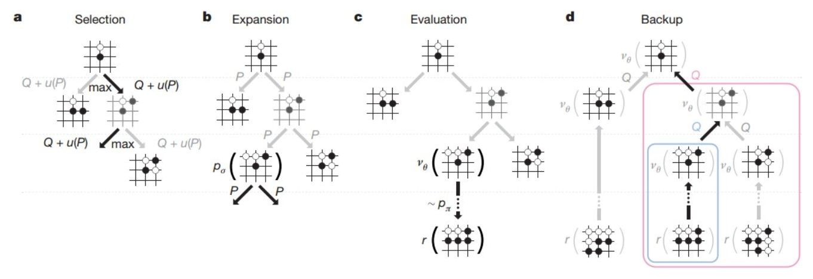

## Single-Agent Search

### Formulation and Search Strategies

- Search problem: State space $S$, start $s_{\mathrm{start}}$, $\operatorname{Actions}(s)$, successor $\operatorname{Succ}(s,a)$, $\operatorname{Cost}(s,a)$, and goal test $\operatorname{IsEnd}(s)$; find a minimum-cost action plan to a goal.
- Fringe priority ($g(n)$: backward path cost; $h(n)$: estimated forward cost to goal):

| Method | Priority | Optimal? | Note |
| :--- | :--- | :--- | :--- |
| UCS | $g(n)$ | Yes ($\text{cost} \ge 0$) | Explores uniform cost contours ($h=0$) |
| Greedy | $h(n)$ | No | Myopic forward estimate only |
| A\* | $f(n) = g(n) + h(n)$ | Yes (admissible / consistent $h$) | Optimal efficiency among exact methods |

- Goal-test rule: Stop only when a goal is **popped for expansion**, never when first pushed onto the fringe.

### A\* Tree Search vs. Graph Search

::: {#def-ai-1-1 name="Admissible and Consistent Heuristics"}

- Admissible (optimistic): $0 \le h(n) \le h^*(n)$, where $h^*(n)$ is true minimum cost to a goal.
- Consistent (triangle inequality): $h(n) \le \operatorname{cost}(n \to n') + h(n')$ for every arc $n \to n'$.

:::

- A\* tree-search optimality: For optimal goal $A$ and suboptimal goal $B$, any unexpanded ancestor $n$ of $A$ satisfies $f(n) \le g(A) < g(B) = f(B)$, so $A$ is expanded before $B$.
- Graph search: Maintain a **closed set** (hash/tree set) of expanded states to avoid exponential repeated-state work.
- Why consistency matters:
  - Implies admissibility, and forces non-decreasing $f(n') \ge f(n)$ along paths.
  - Guarantees A\* graph search expands every state along an optimal path first.
- Relaxed-problem heuristics: Exact optimal cost $h(s) = \operatorname{FutureCost}^j(s)$ in a relaxed problem ($\operatorname{Cost}^j \le \operatorname{Cost}$, e.g., Manhattan distance) is automatically consistent; if $h_1, h_2$ are consistent, so is $\max\{h_1, h_2\}$.

### Motion Planning Variants

- Cell decomposition: Partition space into free, obstacle, and mixed cells; search free cells and recursively split mixed cells.
- Visibility graph: Connect mutually visible polygonal obstacle vertices ($O(n^2)$ edges) to find exact Euclidean shortest paths.
- Weighted A\*: Priority $f(s) = g(s) + \varepsilon h(s)$ ($\varepsilon > 1$) gives large speedups with $\varepsilon$-suboptimal cost ($\le \varepsilon \cdot \text{opt}$).
- **Hybrid A\***: Searches $(x, y, \theta)$ grid cells using continuous kinematically feasible motion primitives $s' = F(s, u)$.

{.notes-slide-fig width="74%" fig-align="center"}

## Adversarial Search and Game Theory

### Minimax and Alpha-Beta Pruning

- Turn-based game: States $S$, players $P$, actions $A$, transition $S \times A \to S$, terminal test, and utilities (zero-sum: $u_2 = -u_1$; general-sum: independent payoffs). Solution is a policy $\pi: S \to A$.
- Minimax (2-player zero-sum): MAX maximizes $\max_{s'} V(s')$, MIN minimizes $\min_{s'} V(s')$; takes $O(b^m)$ time and $O(bm)$ space.

{.notes-slide-fig width="78%" fig-align="center"}

- Alpha-Beta pruning: Track $\alpha$ (best value MAX can guarantee on path) and $\beta$ (best value MIN can guarantee); prune remaining children whenever $v \ge \beta$ at MAX or $v \le \alpha$ at MIN, preserving exact root value:

```python
def max_value(s, alpha, beta):
    if is_terminal(s): return utility(s)
    v = -inf
    for s_next in successors(s):
        v = max(v, min_value(s_next, alpha, beta))
        if v >= beta: return v
        alpha = max(alpha, v)
    return v
```

- Move ordering & cutoffs:
  - Perfect move ordering cuts time from $O(b^m)$ to $O(b^{m/2})$ (doubles solvable depth).
  - Depth-limited minimax: Combine iterative deepening with a linear feature evaluation $\operatorname{Eval}(s) = \sum_i w_i f_i(s)$ at cutoff leaves.

{.notes-slide-fig width="48%" fig-align="center"}

### Normal-Form Games and Nash Equilibrium

- Strategies: Pure strategy picks one action deterministically; mixed strategy randomizes over actions. Player $i$'s best response is $\operatorname{BR}_i(s_{-i}) = \arg\max_{s_i} u_i(s_i, s_{-i})$.

::: {#def-ai-1-2 name="Nash Equilibrium"}

Profile $s^* = (s_1^*, \dots, s_N^*)$ is a Nash equilibrium if $s_i^* \in \operatorname{BR}_i(s_{-i}^*)$ for all $i$ (no profitable unilateral deviation):

$$
\forall\,i,\, s_i: \quad u_i(s_i^*, s_{-i}^*) \ge u_i(s_i, s_{-i}^*).
$$

:::

- Computing NE: Find mutual best-response cells, eliminate strictly dominated strategies, or use the **indifference principle**—every pure action in the support of a mixed NE yields equal expected payoff (e.g., $(\frac13,\frac13,\frac13)$ in Rock–Paper–Scissors).

::: {#thm-ai-1-1 name="Nash Existence & von Neumann Minimax"}

1. Nash (1950): Every finite game (finitely many players and actions) has at least one pure or mixed Nash equilibrium.
2. von Neumann: In any finite two-player zero-sum game, $\max_{\sigma_1}\min_{\sigma_2} u(\sigma_1,\sigma_2) = \min_{\sigma_2}\max_{\sigma_1} u(\sigma_1,\sigma_2) = v$ (NE coincides with Minimax).

:::

### Monte Carlo Tree Search (MCTS)

For high-branching games ($b \approx 361$ in Go), MCTS grows an asymmetric tree online via four steps per iteration:

1. Selection: Traverse from root via tree policy (**UCT**) to an expandable node:

   $$
   \operatorname{UCT}_j = \overline{X}_j + 2 C_p \sqrt{\frac{2\ln n}{n_j}} \qquad (n_j = 0 \implies \infty).
   $$

2. Expansion: Add unvisited child node(s).
3. Simulation: Roll out from the new node to termination using a fast default policy.
4. Backpropagation: Update visit counts $n_j$ and win rates $\overline{X}_j$ along the visited path.

- Decision & AlphaGo: Final root move uses Max (highest $\overline{X}_j$), Robust (highest $n_j$), or Max-Robust child. Vanilla MCTS is anytime and domain-agnostic but can miss narrow traps; AlphaGo guides expansion and evaluation with policy nets ($p_\sigma, p_\pi, p_\rho$) and a value net $v_\theta$.

{.notes-slide-fig width="92%" fig-align="center"}

### Expected Utility and Rationality

- Cardinal vs. ordinal utility: Minimax is invariant to any monotonic transform of utilities; stochastic expectation requires cardinal utilities (invariant only up to positive affine transforms).
- Rationality axioms on lotteries $L = [p, A;\, 1-p, B]$: Orderability, Transitivity (violating it creates a "money pump"), Continuity, Substitutability, and Monotonicity.

::: {.callout-note title="vNM Utility Theorem & Human Risk Behavior" collapse="true"}

- Ramsey / vNM Theorem: Preferences obeying the five axioms admit a utility $U$ with $A \succeq B \iff U(A) \ge U(B)$ and $U([p_1, S_1; \dots; p_n, S_n]) = \sum_i p_i U(S_i)$ (**Maximum Expected Utility**).
- Risk preferences: Concave $U(\text{money})$ implies risk aversion ($U(L) < U(\operatorname{EMV}(L))$, motivating insurance premiums); human choices systematically violate vNM independence under certainty effects (*Allais paradox*).

:::
