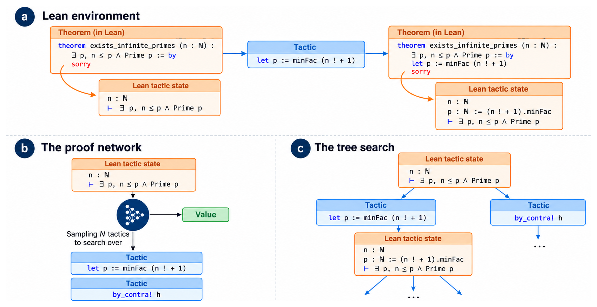

A logical language balances expressivity and computational efficiency via three parts: syntax (well-formed formulas), semantics (satisfying models $\mathcal{M}(f)$), and inference rules (syntactic derivations $\mathrm{KB} \vdash f$).

## Representation

### Propositional Logic

- Syntax: Atomic symbols $A, B, C, \dots$ combined via $\neg f$, $f \land g$, $f \lor g$, $f \to g$, and $f \leftrightarrow g$.
- Semantics: A **model** $w \in \{0,1\}^n$ assigns truth values to all $n$ symbols ($2^n$ models); $\mathcal{I}(f, w) \in \{0,1\}$ evaluates truth recursively ($\mathcal{I}(f \to g, w) = 1 \iff \mathcal{I}(f,w) \le \mathcal{I}(g,w)$).
- Knowledge base: Set of formulas $\mathrm{KB}$ with model set $\mathcal{M}(\mathrm{KB}) = \bigcap_{f \in \mathrm{KB}} \mathcal{M}(f)$.

### First-Order Logic (FOL)

- Syntax:
  - Terms (objects): constants $c$, variables $x$, and functions $f(t_1, \dots, t_n)$.
  - Formulas (truth values): predicates $P(t_1, \dots, t_n)$, equality $=$, connectives, and quantifiers $\forall x$, $\exists x$.
- Quantifier rules:
  - Idioms: $\forall x\,(P(x) \to Q(x))$ vs. $\exists x\,(P(x) \land Q(x))$.
  - Duality & order: $\neg\forall x\,P(x) \equiv \exists x\,\neg P(x)$; $\forall x\,\exists y \not\equiv \exists y\,\forall x$.
- Semantics & **propositionalization**: A model maps constants/functions/predicates over an object domain $D$. FOL reduces to propositional logic iff *unique names* (at most one constant per object) and *domain closure* (at least one constant per object, finite $D$) hold.

## Inference

### Entailment and SAT

- Semantic relations between $\mathrm{KB}$ and query $f$:
  - Entailment ($\mathrm{KB} \models f$): $\mathcal{M}(\mathrm{KB}) \subseteq \mathcal{M}(f)$ (`Ask[f]` = Yes).
  - Contradiction ($\mathrm{KB} \models \neg f$): $\mathcal{M}(\mathrm{KB}) \cap \mathcal{M}(f) = \emptyset$ (`Ask[f]` = No).
  - Contingency: Nonempty proper overlap (`Ask[f]` = Don't know).
- Reduction to SAT ($\mathcal{M}(\mathrm{KB}) \ne \emptyset$): $\mathrm{KB} \models f \iff \mathrm{KB} \cup \{\neg f\}$ is unsatisfiable.
- SAT solvers (viewing SAT as a CSP): DPLL (backtracking + unit propagation + pruning) and WalkSAT (randomized local variable flips).

### Horn Clauses, Modus Ponens, and Unification

- **Horn clause**: Clause with *at most one* positive literal—either a definite clause $(p_1 \land \dots \land p_k) \to q$ or goal clause $(p_1 \land \dots \land p_k) \to \mathrm{false}$.
- Propositional Modus Ponens: Derives $q$ from $p_1, \dots, p_k$ and $(p_1 \land \dots \land p_k) \to q$ in linear time.
- First-order Modus Ponens: Given substitution $\theta = \operatorname{Unify}\bigl((a_1',\dots,a_k'),\,(a_1,\dots,a_k)\bigr)$ (**most general unifier**, MGU):

  $$
  \frac{a_1', \dots, a_k', \qquad \forall x_1 \cdots \forall x_n \bigl((a_1 \land \dots \land a_k) \to b\bigr)}{\operatorname{Subst}[\theta, b]}.
  $$

::: {#thm-ai-2-1 name="Completeness & Semi-Decidability on Horn Clauses"}

- Modus Ponens (with unification) is complete for propositional and FOL Horn clauses.
- Function symbols generate infinitely many ground terms ($a, F(a), F(F(a)), \dots$), making FOL **semi-decidable** (halts if $\mathrm{KB} \models f$, may loop forever if $\mathrm{KB} \not\models f$).

:::

### Resolution and CNF

Modus Ponens cannot cancel general disjunctions; first-order resolution resolves complementary literals with $\theta = \operatorname{Unify}[p, q]$:

$$
\frac{f_1 \lor \cdots \lor f_n \lor p, \qquad \neg q \lor g_1 \lor \cdots \lor g_m}{\operatorname{Subst}[\theta,\, f_1 \lor \cdots \lor f_n \lor g_1 \lor \cdots \lor g_m]}.
$$

::: {#prp-ai-2-1 name="CNF Conversion Steps"}

1. Eliminate $\leftrightarrow$ and $\to$ ($f \to g \leadsto \neg f \lor g$).
2. Push $\neg$ inward (De Morgan + quantifier duality) and drop $\neg\neg$.
3. *(FOL)* Standardize variables apart, **Skolemize** $\exists$ into fresh constants / Skolem functions of enclosing $\forall$-variables ($\forall x\,\exists y \leadsto Y(x)$), and drop $\forall$.
4. Distribute $\lor$ over $\land$.

:::

- **Resolution refutation**: Convert $\mathrm{KB} \cup \{\neg f\}$ to CNF and resolve until deriving the empty clause ($\mathrm{false}$); sound and complete, exponential worst-case time.

## Soundness, Completeness, and Verification

::: {#def-ai-2-1 name="Soundness and Completeness"}

- Soundness ("nothing but the truth"): $\{f : \mathrm{KB} \vdash f\} \subseteq \{f : \mathrm{KB} \models f\}$.
- Completeness ("the whole truth"): $\{f : \mathrm{KB} \vdash f\} \supseteq \{f : \mathrm{KB} \models f\}$.

:::

| Language | Horn Clauses (Fast / Linear) | General CNF (Expressive / Exponential) |
| :--- | :--- | :--- |
| Propositional Logic | Modus Ponens | SAT (DPLL / WalkSAT) or Resolution |
| First-Order Logic | Modus Ponens + Unification | Propositionalization or Resolution + Unification |

### Formal Verification and AlphaProof

- Proof search vs. proof checking: Finding a tactic proof faces huge branching factors (timeout $\ne$ disproof), whereas checking a completed proof term in a kernel (**Lean**) is deterministic and fast.
- Trust boundary: Lean guarantees the proof validly proves the *formalized statement*, even from an untrusted LLM, but cannot verify that the formalization matches human intent.
- AlphaProof: Pairs Lean's tactic kernel (exact RL verification signal) with a policy/value network and tree search over proof states.

{.notes-slide-fig width="92%" fig-align="center"}
