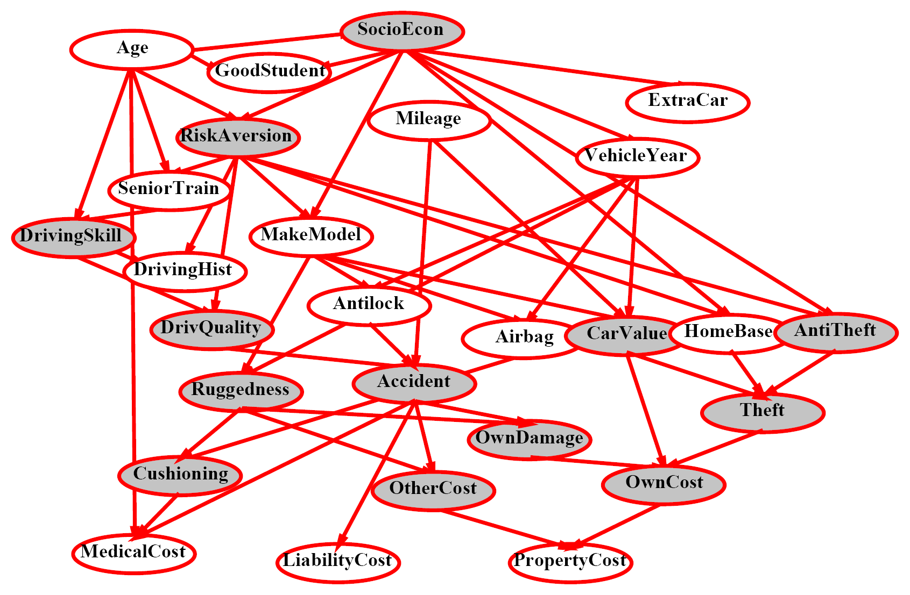

## Probability Fundamentals

- Joint distribution $P(X_1, \dots, X_n)$: Table of size $O(d^n)$ for domain size $d$—exponentially costly to store or estimate.
- Core rules:
  - Marginalization: $P(a) = \sum_b P(a, b)$.
  - Conditioning & normalization trick: $P(a \mid b) = \dfrac{P(a, b)}{P(b)} \propto_A P(a, b)$ (select joint rows matching $b$, then normalize their sum $P(b)$ to $1$).
  - Product & chain rules: $P(a, b) = P(a \mid b)P(b)$, $\quad P(x_1, \dots, x_n) = \prod_{i=1}^n P(x_i \mid x_1, \dots, x_{i-1})$.
  - Bayes' rule:

    $$
    P(x \mid y) = \frac{P(y \mid x)P(x)}{P(y)} = \frac{P(y \mid x)P(x)}{\sum_{x'} P(y \mid x')P(x')}.
    $$

- **Conditional independence** ($X \perp\!\!\!\perp Y \mid Z$): $P(x, y \mid z) = P(x \mid z)P(y \mid z) \iff P(x \mid y, z) = P(x \mid z)$ (e.g., $\mathrm{Catch} \perp\!\!\!\perp \mathrm{Toothache} \mid \mathrm{Cavity}$, whereas marginally $\mathrm{Catch} \not\perp\!\!\!\perp \mathrm{Toothache}$).

## Bayesian Networks

### Syntax and Factorization

- Components: A DAG (one node per variable $X_i$) plus a local **Conditional Probability Table (CPT)** $P(X_i \mid \operatorname{Parents}(X_i))$ at each node.

{.notes-slide-fig width="80%" fig-align="center"}

{.notes-slide-fig width="46%" fig-align="center"}

::: {#def-ai-3-1 name="Bayesian Network Joint Factorization"}

Assuming $X_i \perp\!\!\!\perp \{X_1,\dots,X_{i-1}\} \setminus \operatorname{Parents}(X_i) \mid \operatorname{Parents}(X_i)$ in topological order:

$$
P(x_1, \dots, x_n) = \prod_{i=1}^n P\bigl(x_i \mid \operatorname{Parents}(X_i)\bigr).
$$

:::

- Graph semantics vs. causality: Arcs encode conditional independence, not physical causation ($T \to R$ and $R \to T$ can represent the exact same joint $P(R, T)$), though causal ordering yields sparser graphs and simpler CPTs.

### D-Separation

Every undirected path between $X$ and $Y$ decomposes into three-node triples given evidence $Z$:

| Triple | $M \notin Z$ | $M \in Z$ | Mechanism |
| :--- | :--- | :--- | :--- |
| Causal chain ($X \to M \to Y$) | Active | Blocked ($\perp\!\!\!\perp$) | Observing $M$ intercepts flow |
| Common cause ($X \leftarrow M \to Y$) | Active | Blocked ($\perp\!\!\!\perp$) | Observing $M$ explains correlation |
| Common effect ($X \to M \leftarrow Y$) | Blocked ($\perp\!\!\!\perp$) | Active (if $M$ or descendant $\in Z$) | *Explaining away*: causes compete |

::: {#def-ai-3-2 name="D-Separation Rule"}

1. Shade evidence nodes $Z$ and inspect all undirected paths between $X$ and $Y$.
2. A path is active iff *every* triple along it is active; one blocked triple blocks the path.
3. If no path is active, $X$ and $Y$ are **d-separated** $\implies X \perp\!\!\!\perp Y \mid Z$ in all distributions compatible with the DAG *(specific numerical CPTs may hold accidental extra independencies)*.

:::

## Exact Inference Basics

### Enumeration and Factors

Partition variables into query $Q$, observed evidence $e$, and hidden $H$:

$$
P(Q \mid e) = \frac{P(Q, e)}{P(e)} = \frac{1}{Z} \sum_h P(Q, h, e) = \frac{1}{Z} \sum_h \prod_{i=1}^n P\bigl(x_i \mid \operatorname{Parents}(X_i)\bigr).
$$

Three algebraic operations on multidimensional probability tables (**factors**):

1. Evidence instantiation: Restrict each initial CPT to rows matching observed $e$.
2. Join (`×`): Pointwise product over the union of variables (e.g., $P(R) \times P(T \mid R) = P(R, T)$); any variable unconditioned (left of `|`) in *any* input factor becomes unconditioned in the output factor.
3. Eliminate (`∑`): Sum out a hidden variable from a factor, projecting onto remaining variables.

- Bottleneck of enumeration: Joining all factors before summing out $H$ builds an $O(d^n)$ table—motivating Variable Elimination in Chapter 4.
