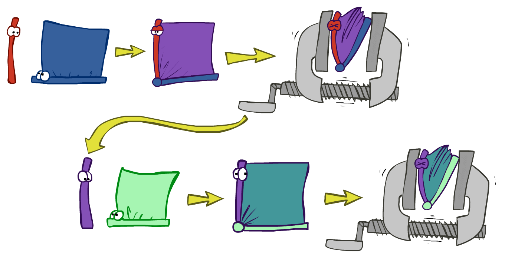

## Exact Inference: Variable Elimination

Variable Elimination (VE) pushes sums inside products ($\sum uwy + \cdots = (u+v)(w+x)(y+z)$) by interleaving joins and marginalization:

1. Restrict all local CPTs to observed evidence $e$.
2. For each hidden variable $H_k$ (in chosen elimination order): join all factors mentioning $H_k$, then eliminate (sum out) $H_k$.
3. Join remaining factors over $Q$ and normalize.

{.notes-slide-fig width="78%" fig-align="center"}

- Complexity: Governed by the largest intermediate factor; elimination order can mean $2^n$ vs. $2$ entries (e.g., eliminating a star hub first vs. last).
- Hardness: Exact BN inference is **NP-hard** (reduces from 3-SAT), but runs in linear time on **polytrees** (singly connected DAGs with no undirected cycles).

## Approximate Inference via Sampling

Draw $N$ discrete samples (via inverse-CDF lookup on $u \sim \operatorname{Uniform}[0,1)$) to approximate $P(Q \mid e)$:

| Method | Procedure | Pros & Cons |
| :--- | :--- | :--- |
| Prior Sampling | Sample $x_i \sim P(X_i \mid \mathrm{pa})$ topologically | Unbiased for $P(X)$; ignores evidence $e$ |
| Rejection Sampling | Prior sample; discard if $x_i \ne e_i$ | Consistent, but rejects almost all samples when $P(e)$ is small |
| Likelihood Weighting | Clamp $E_i = e_i$, sample rest; weight $w = \prod_i P(e_i \mid \mathrm{pa})$ | Uses all samples ($S_{\mathrm{WS}} \cdot w = P(\mathbf{z}, \mathbf{e})$), but upstream ignores downstream $e$ (weight collapse) |
| Gibbs Sampling (MCMC) | Clamp $e$; repeatedly resample $Z_i \sim P(Z_i \mid \mathrm{MB}(Z_i))$ | Uses upstream & downstream evidence; correlated samples, slow mixing diagnosis |

Key Gibbs sampling details:

- **Markov blanket** $\mathrm{MB}(Z_i)$: All CPTs not mentioning $Z_i$ cancel in $P(Z_i \mid x_{-i})$, leaving only $P(Z_i \mid \operatorname{Parents}(Z_i)) \prod_{Y_j \in \operatorname{Children}(Z_i)} P(Y_j \mid \operatorname{Parents}(Y_j))$ (parents, children, and co-parents).
- Convergence: Kernel $q(x \to x') = P(x_i' \mid x_{-i}, e)$ satisfies **detailed balance** with $P(x \mid e)$ (Metropolis–Hastings with acceptance $1$).

## Probabilistic Reasoning over Time

### Markov Chains and Stationary Distributions

- Markov chain: Prior $P(X_1)$ and stationary transition $P(X_t \mid X_{t-1})$ with $X_t \perp\!\!\!\perp X_{1:t-2} \mid X_{t-1}$; forward propagation updates $P(x_t) = \sum_{x_{t-1}} P(x_t \mid x_{t-1})P(x_{t-1})$.

::: {#def-ai-4-1 name="Stationary Distribution"}

Ergodic chains converge to a unique $P_\infty$ invariant under transitions: $P_\infty(x') = \sum_x P(x' \mid x)P_\infty(x)$.

- PageRank: Surfer jumps to a uniform random page with probability $c$ and follows an outlink with probability $1-c$; $P_\infty$ ranks page authority.

:::

### Hidden Markov Models and Filtering

::: {#def-ai-4-2 name="Hidden Markov Model (HMM)"}

Hidden states $X_{1:T}$ emit noisy observations $E_{1:T}$ via $P(X_1)$, $P(X_t \mid X_{t-1})$, and $P(E_t \mid X_t)$, with $X_t \perp\!\!\!\perp X_{1:t-2}, E_{1:t-1} \mid X_{t-1}$ and $E_t \perp\!\!\!\perp X_{1:t-1}, E_{1:t-1} \mid X_t$.

:::

- Online filtering (Forward Algorithm) updates belief $B_t(x_t) = P(x_t \mid e_{1:t})$ in $O(|X|^2)$ time and $O(|X|)$ space per step (*Kalman filter* for linear-Gaussian systems):
  1. Time elapse: $B'_t(x_t) = \sum_{x_{t-1}} P(x_t \mid x_{t-1}) B_{t-1}(x_{t-1})$.
  2. Observe: $B_t(x_t) \propto_{X_t} P(e_t \mid x_t) B'_t(x_t)$.
- Particle filtering ($O(N)$ per step for $N \ll |X|$ particles, when $|X|$ is huge or continuous):
  1. Elapse: Sample $x_t^{(i)} \sim P(X_t \mid x_{t-1}^{(i)})$.
  2. Weight: Set $w_i = P(e_t \mid x_t^{(i)})$.
  3. Resample: Draw $N$ unweighted particles proportional to $\{w_i\}$.
  - SLAM: Jointly filters robot pose and map (e.g., FastSLAM).

### DBNs, Viterbi, and Probabilistic Programming

- Dynamic Bayes Nets (DBNs): Multi-variable BN slice repeated across $t-1 \to t$; particle filtering tracks state-tuple particles.
- Viterbi algorithm ($\arg\max_{x_{1:T}} P(x_{1:T} \mid e_{1:T})$): Replaces the Forward sum over trellis paths with a `max` (plus backpointers):

  $$
  \begin{aligned}
  \text{Forward:}\quad f_t[x_t] &= P(e_t \mid x_t)\sum_{x_{t-1}} P(x_t \mid x_{t-1})\,f_{t-1}[x_{t-1}], \\
  \text{Viterbi:}\quad m_t[x_t] &= P(e_t \mid x_t)\max_{x_{t-1}} P(x_t \mid x_{t-1})\,m_{t-1}[x_{t-1}].
  \end{aligned}
  $$

- Probabilistic programming (PyMC, Stan, Edward): Expresses generative models as code with automated MCMC/variational posterior inference.
