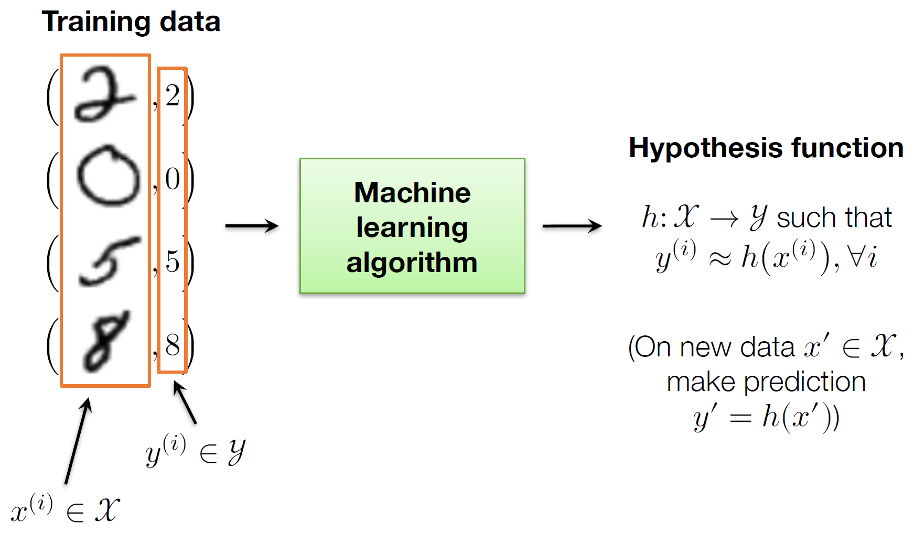
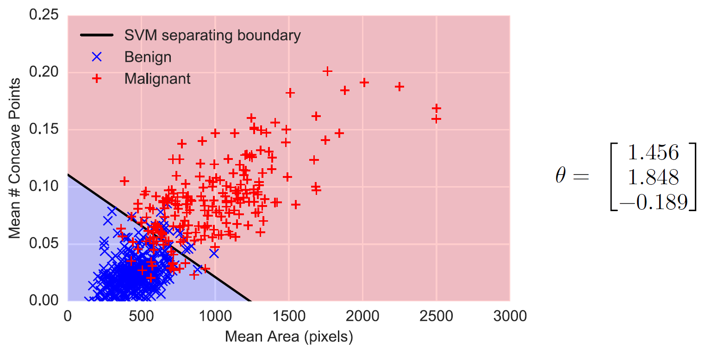
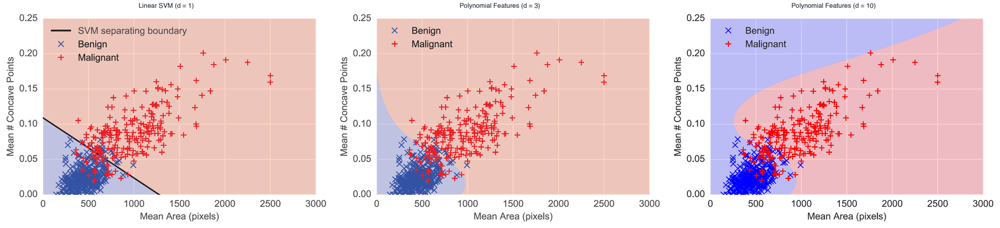

- Supervised learning: Learn $x^{(i)} \mapsto y^{(i)}$ from labeled pairs (regression if $y \in \mathbb{R}$, classification if $y$ is discrete).
- Unsupervised learning: Extract structure from unlabeled $x^{(i)}$ alone (clustering, dimensionality reduction).

## Linear Regression

### Canonical Setup

Given $(x^{(i)}, y^{(i)})_{i=1}^m$ with $x^{(i)} \in \mathbb{R}^n$ (appending $1$ for the intercept), every supervised method specifies three parts: hypothesis $h_\theta$, loss $\ell$, and optimizer:

::: {#def-ai-5-1 name="Canonical Machine Learning Problem"}

$$
\min_{\theta \in \mathbb{R}^n} \sum_{i=1}^m \ell\bigl(h_\theta(x^{(i)}),\, y^{(i)}\bigr).
$$

:::

{.notes-slide-fig width="74%" fig-align="center"}

### Least Squares and $\ell_1$ Regression

With $h_\theta(x) = \theta^\top x$, squared loss, and rows $x^{(i)\top}$ stacked into $X \in \mathbb{R}^{m \times n}$, least squares minimizes the convex objective $\min_\theta \|X\theta - y\|_2^2$ ($\nabla_\theta = 2X^\top(X\theta - y)$):

- Gradient descent: $\theta \leftarrow \theta - 2\alpha X^\top(X\theta - y)$.
- **Normal equations** (closed form): $X^\top X \theta^* = X^\top y \implies \theta^* = (X^\top X)^{-1} X^\top y$.
- $\ell_1$ regression ($\min_\theta \|X\theta - y\|_1$): Outlier-robust and convex; no closed form, solved via subgradient $X^\top \operatorname{sign}(X\theta - y)$.

## Linear Classification

### Surrogate Losses, SVM, and Logistic Regression

- Binary setup: $y \in \{-1, +1\}$, score $h_\theta(x) = \theta^\top x$, prediction $\hat{y} = \operatorname{sign}(h_\theta(x))$, margin $y \cdot h_\theta(x)$.
- Why surrogates: Squared loss penalizes confident correct margins ($y \cdot h_\theta(x) \gg 1$), while exact $0/1$ loss is non-convex (NP-hard):

| Loss | Formula $\ell(h_\theta(x), y)$ | Smooth? | Model |
| :--- | :--- | :--- | :--- |
| $0/1$ loss | $\mathbf{1}\{y \cdot h_\theta(x) \le 0\}$ | No | Exact error (NP-hard) |
| Hinge | $\max\{1 - y \cdot h_\theta(x),\, 0\}$ | Piecewise | Linear SVM |
| Logistic | $\log\bigl(1 + \exp(-y \cdot h_\theta(x))\bigr)$ | Yes | Logistic regression |
| Exponential | $\exp\bigl(-y \cdot h_\theta(x)\bigr)$ | Yes | AdaBoost |

- Linear SVM: Minimizes hinge loss (+ $\frac{\lambda}{2}\|\theta\|_2^2$); subgradient updates only on margin violations ($y^{(i)}\theta^\top x^{(i)} \le 1$):

  $$
  \theta \leftarrow \theta + \alpha \sum_{i=1}^m y^{(i)} x^{(i)}\, \mathbf{1}\bigl\{y^{(i)}\theta^\top x^{(i)} \le 1\bigr\}.
  $$

{.notes-slide-fig width="76%" fig-align="center"}

- Logistic regression: Minimizes $\lambda\|\theta\|_2^2 + \sum_{i=1}^m \log(1 + e^{-y^{(i)}\theta^\top x^{(i)}})$ via GD or Newton's method; models $p(y = +1 \mid x) = \sigma(\theta^\top x) = (1 + e^{-\theta^\top x})^{-1}$.
- Multiclass ($y \in \{1,\dots,k\}$):
  - One-vs-all: Train $k$ binary classifiers $h_{\theta_j}$ and predict $\arg\max_j h_{\theta_j}(x)$.
  - Softmax (cross-entropy): For $h_\theta: \mathbb{R}^n \to \mathbb{R}^k$, minimize $\ell(h_\theta(x), y) = \log\sum_{j=1}^k \exp(h_\theta(x)_j) - h_\theta(x)_y$.

## Nonlinear Methods

- Nonlinear features: Apply linear models to $\phi(z)$ (e.g., polynomials $[z^d,\dots,z,1]^\top$)—nonlinear in $z$, still linear in $\theta$.
- Kernel methods: $h_\theta(x) = \sum_{i=1}^m \theta_i K(x, x^{(i)})$ where $K(x,z) = \phi(x)^\top \phi(z)$ computes high-dimensional inner products implicitly; linear in $\theta \in \mathbb{R}^m$, **non-parametric** ($m$ weights).
- $k$-Nearest Neighbors ($k$-NN): Vote or average over the $k$ closest training points under $\operatorname{dist}(x, x^{(i)})$; no training step, $O(m)$ storage.
- Decision trees: Greedily split features ($x_j \le t$) to partition $\mathbb{R}^n$; leaves output labels or local linear fits.
- Neural networks: Composed affine + nonlinear layers, e.g., $h_\theta(x) = \sigma(\theta_2^\top \sigma(\Theta_1^\top x))$.
- Ensembles ($h_\theta(x) = \sum_{j=1}^k \theta_j \operatorname{sign}(h_j(x))$): Random forests (trees on bootstrap data/features) and boosting (reweighting prior errors).

## Generalization, Regularization, and Evaluation

### Overfitting and Cross-Validation

- **Overfitting**: High-capacity models fit training noise (low training loss, high generalization error). Fit parameters $\theta$ on training data; tune hyperparameters ($d, \lambda, k$) on validation data.
- **$k$-fold CV**: Average validation loss across $k$ held-out folds. Variants: leave-one-out ($k=m$, fast in closed form for least squares) and stratified CV (preserves class ratios). *Time-series rule*: validation data must strictly follow training data in time.

{.notes-slide-fig width="92%" fig-align="center"}

### Regularization and Evaluation Protocol

::: {#def-ai-5-2 name="Regularized Loss & Ridge Regression"}

Penalizing $\|\theta\|_2^2$ damps large oscillating weights ($\lambda$: fit vs. complexity trade-off):

$$
\min_\theta \sum_{i=1}^m \ell\bigl(h_\theta(x^{(i)}),\, y^{(i)}\bigr) + \frac{\lambda}{2}\|\theta\|_2^2.
$$

For $\frac{1}{2}\|X\theta - y\|_2^2 + \frac{\lambda}{2}\|\theta\|_2^2$, the closed-form solution is $\theta^* = (X^\top X + \lambda I)^{-1} X^\top y$.

:::

- Train / Validation / Test split:
  1. Fit $\theta$ on Train; tune hyperparameters/models on Validation (never on Test, or hyperparameters overfit the holdout).
  2. Report final performance *once* on Test—repeatedly tuning against Test leaks information (mitigate with fresh live data and sparse test checks).

## Unsupervised Learning

Minimize squared **reconstruction loss** $\sum_{i=1}^m \|x_i - h_\theta(x_i)\|_2^2$ on unlabeled $x_1, \dots, x_m \in \mathbb{R}^n$:

- $k$-Means ($h_\theta(x) = \mu_{\arg\min_j \|x - \mu_j\|_2^2}$): Non-convex; alternate (1) assigning each $x_i$ to its nearest centroid $\mu_j$, and (2) updating $\mu_j$ to the mean of assigned points.
- PCA ($h_\theta(x) = \Theta_1 \Theta_2 x$ with $\Theta_2 \in \mathbb{R}^{k \times n}, \Theta_1 \in \mathbb{R}^{n \times k}$, $k < n$): Non-convex in $(\Theta_1, \Theta_2)$, but solved in closed form via top-$k$ eigenvectors of $\sum_i x_i x_i^\top$ ($\Theta_1 = U_k, \Theta_2 = U_k^\top$).
