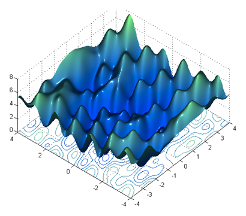

## Neural Networks

Purely linear layers collapse ($W_2(W_1 x) = (W_2 W_1)x$); inserting elementwise nonlinearities $f_i$ learns hierarchical features directly on GPUs via dense matrix operations:

$$
z_1 = x, \qquad z_{i+1} = f_i(W_i z_i + b_i) \quad (i = 1, \dots, k-1), \qquad h_\theta(x) = z_k.
$$

### Activations and Universal Approximation

- Common activations: $\tanh(x) = \dfrac{e^{2x}-1}{e^{2x}+1} \in (-1,1)$, sigmoid $\sigma(x) = \dfrac{1}{1+e^{-x}} \in (0,1)$, and ReLU $\max\{x, 0\}$.

```{python}
#| echo: false
#| warning: false
#| out-width: 100%
#| fig-align: center

import numpy as np
import matplotlib.pyplot as plt

x = np.linspace(-5, 5, 400)
specs = [
    (r"Tanh $\tanh(x)$", np.tanh(x), (-1.28, 1.28), [-1, 0, 1], ["-1", "0", "1"], [-1, 1], (0, 0)),
    (r"Sigmoid $\sigma(x)$", 1 / (1 + np.exp(-x)), (-0.22, 1.22), [0, 0.5, 1], ["0", "0.5", "1"], [0, 1], (0, 0.5)),
    (r"ReLU $\max(x, 0)$", np.maximum(0, x), (-0.6, 5.2), [0, 2, 4], ["0", "2", "4"], [], (0, 0)),
]

fig, axes = plt.subplots(1, 3, figsize=(7.6, 2.35))
fig.patch.set_alpha(0.0)
ink, muted, grid_c, accent = "#5c6670", "#85909b", "#9aa5b1", "#3b78b0"

for ax, (title, y, ylim, yticks, ylabels, asym, pt) in zip(axes, specs):
    ax.set_facecolor("none")
    ax.grid(True, color=grid_c, lw=0.6, alpha=0.22)
    ax.set_axisbelow(True)
    for a in asym:
        ax.axhline(a, color=muted, ls="--", lw=0.85, alpha=0.55)
    ax.axhline(0, color=muted, lw=0.85, alpha=0.45)
    ax.axvline(0, color=muted, lw=0.85, alpha=0.45)
    ax.fill_between(x, 0, y, color=accent, alpha=0.07)
    ax.plot(x, y, color=accent, lw=2.2, solid_capstyle="round")
    ax.scatter([pt[0]], [pt[1]], color=accent, s=22, zorder=4)
    ax.set_title(title, fontsize=10.5, fontweight="bold", color=ink, pad=9)
    ax.set_xlim(-5, 5)
    ax.set_ylim(*ylim)
    ax.set_xticks([-4, 0, 4])
    ax.set_yticks(yticks)
    ax.set_yticklabels(ylabels)
    ax.tick_params(colors=muted, labelsize=8.5, length=3, width=0.7)
    for spine in ("top", "right"):
        ax.spines[spine].set_visible(False)
    for spine in ("left", "bottom"):
        ax.spines[spine].set_color(muted)
        ax.spines[spine].set_alpha(0.35)
        ax.spines[spine].set_linewidth(0.8)

plt.tight_layout(w_pad=2.0)
plt.show()
```

::: {#thm-ai-6-1 name="Universal Approximation Theorem"}

Any continuous function on a compact domain can be approximated arbitrarily closely by a single-hidden-layer network with enough hidden units (guarantees existence, not compact width or efficient learnability).

:::

## Why Deep?

- Circuit compactness: $n$-bit parity needs $O(2^n)$ units in 1 hidden layer vs. $O(n)$ units across $O(\log n)$ layers.
- Modularity & data efficiency: Lower layers learn reusable sub-features (**learnable kernel** $\phi_\theta(x)$) shared across upper-layer tasks.
- Empirical "thin + tall" > "fat + short": At matched parameter counts, deeper nets outperform wide shallow ones (e.g., $7\times 2\text{k}$ beats $1\times 16\text{k}$ on speech recognition).
- Why now: Large datasets + parallel GPU compute + improved architectures and optimizers.

{.notes-slide-fig width="68%" fig-align="center"}

## Training Neural Networks

### Losses and Minibatch SGD

- Standard losses: Squared $\|h_\theta(x)-y\|_2^2$ (regression), logistic/hinge (binary), and softmax $\log\sum_j e^{h_\theta(x)_j} - h_\theta(x)_y$ (multiclass).
- **Minibatch SGD**: Avoids scanning all $m$ examples per step by updating on a small minibatch $B$:

  $$
  \theta \leftarrow \theta - \frac{\alpha}{|B|}\sum_{i \in B} \nabla_\theta \ell\bigl(h_\theta(x^{(i)}),\, y^{(i)}\bigr).
  $$

### Jacobians and Backpropagation

::: {#def-ai-6-1 name="Jacobian Rules"}

For $f: \mathbb{R}^n \to \mathbb{R}^m$, $\bigl(\frac{\partial f}{\partial x}\bigr)_{ij} = \frac{\partial f_i}{\partial x_j}$ (scalar $f$: $\nabla_x f = (\frac{\partial f}{\partial x})^\top$). Key rules:

- Chain rule: $\dfrac{\partial f(g(x))}{\partial x} = \dfrac{\partial f}{\partial g}\dfrac{\partial g}{\partial x}$.
- Linear & elementwise maps: $\dfrac{\partial(Ax)}{\partial x} = A$, $\quad \dfrac{\partial f(u)}{\partial u} = \operatorname{diag}\bigl(f'(u)\bigr)$.

:::

**Backpropagation** computes all gradients in $O(k n^2)$ time (matrix–vector products, avoiding $O(k n^3)$ matrix–matrix products):

1. Forward ($i = 1, \dots, k-1$): Cache $u_i = W_i z_i + b_i$ and $z_{i+1} = f_i(u_i)$.
2. Backward ($i = k-1, \dots, 1$): From $g_k = \nabla_{z_k}\ell(z_k, y)$, propagate upstream gradients:

   $$
   \delta_i = g_{i+1} \circ f_i'(u_i), \qquad g_i = W_i^\top \delta_i.
   $$

3. Gradients: $\nabla_{b_i}\ell = \delta_i$ and $\nabla_{W_i}\ell = \delta_i z_i^\top$.

::: {.callout-note title="Matrix Gradient via Vectorization" collapse="true"}

Using $\operatorname{vec}(ABC) = (C^\top \otimes A)\operatorname{vec}(B)$, $W_i z_i = (z_i^\top \otimes I)\operatorname{vec}(W_i)$, so $\frac{\partial \ell}{\partial \operatorname{vec}(W_i)} = \delta_i^\top(z_i^\top \otimes I)$, which reshapes to $\nabla_{W_i}\ell = \delta_i z_i^\top$.

:::

### Non-Convexity and Momentum

- Non-convex surfaces contain flat plateaus, saddle points, and local minima (initialization-dependent).
- **Momentum** adds velocity inertia to push past plateaus, saddles, and shallow local traps:

  $$
  v_{t+1} = \beta v_t - \alpha \nabla_\theta \ell(\theta_t), \qquad \theta_{t+1} = \theta_t + v_{t+1}.
  $$

{.notes-slide-fig width="46%" fig-align="center"}
