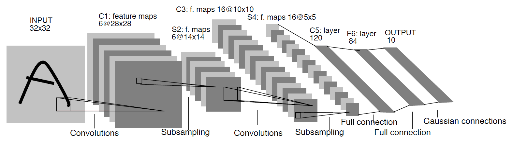
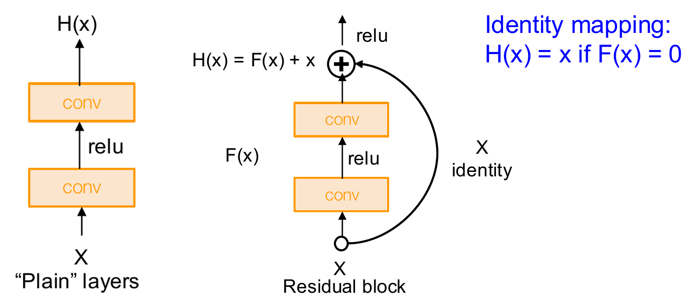
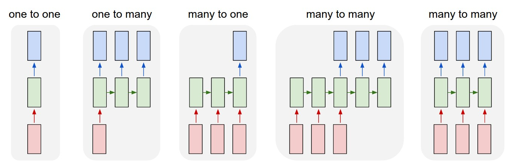
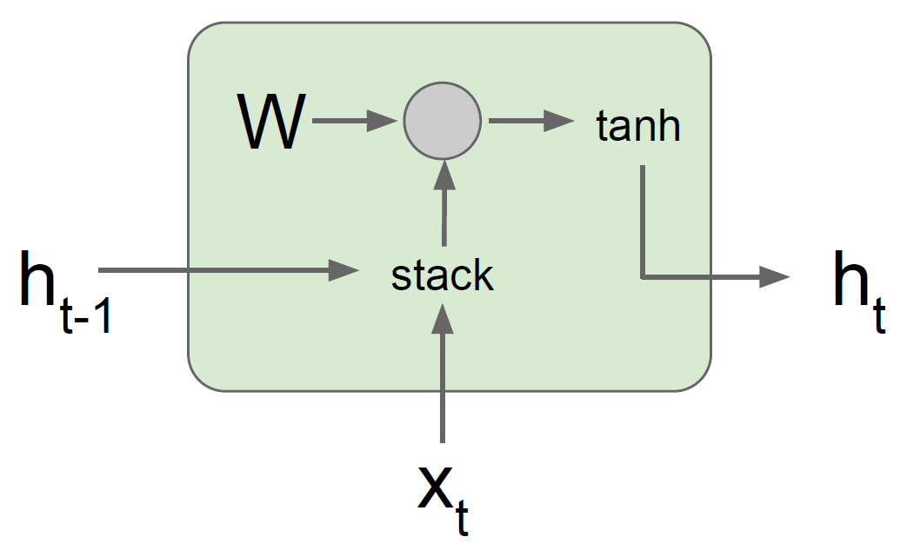
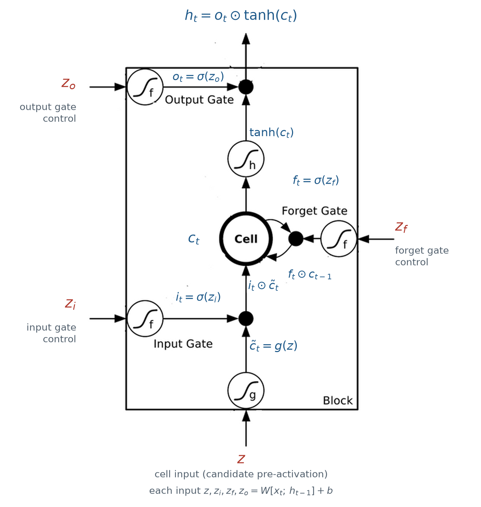
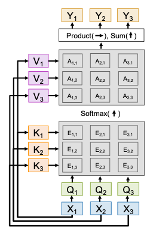
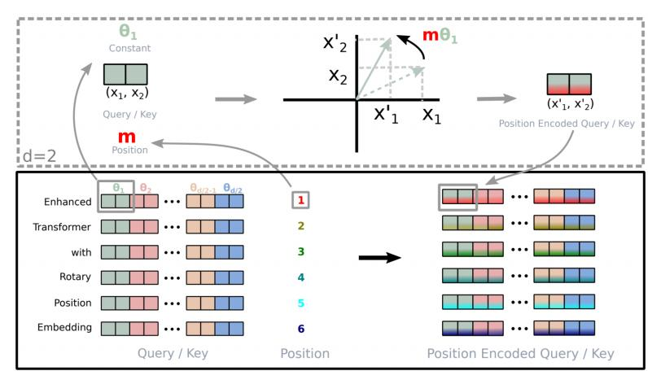
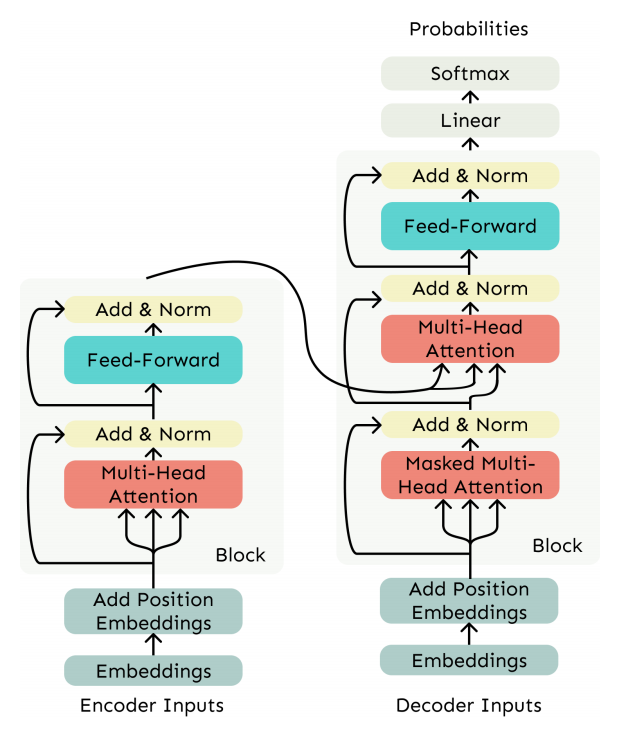

## Convolutional Neural Networks (CNNs)

### Core Layers and Backpropagation

Fully connected nets fail on images due to shift/scale/rotation variations and massive parameter counts. A CNN stacks four layer types:

- Convolution: Slides shared local filters across patches (elementwise multiply + sum) to output **feature maps** with far fewer weights.
- ReLU ($z_i = \max(0, z_{i-1})$): Fast, sparse, avoids cancellation, and mitigates **vanishing gradients** (unit slope $1$ on active units).
- Max pooling ($2\times 2$ or $3\times 3$, stride $2$): Keeps window maxima to cut spatial size, compute, and overfitting (over-pooling limits depth).
- Fully connected: Flattens final features into class logits.

{.notes-slide-fig width="92%" fig-align="center"}

Backpropagation through CNN layers (only conv filters and FC weights are learned):

- Convolution: Linear sparse-matrix operator $\implies$ backward pass applies the transposed operation.
- ReLU (Leaky ReLU $\max(0.1 z_{i-1}, z_{i-1})$ fixes zero-gradient "dying ReLUs"):

  $$
  \frac{\partial L}{\partial z_{i-1}} =
  \begin{cases}
  \dfrac{\partial L}{\partial z_i}, & z_{i-1} > 0, \\[4pt]
  0, & z_{i-1} < 0.
  \end{cases}
  $$

- Max pooling ($k \times k$ window): Forward takes $z_i(x, y) = \max_{0 \le p, q < k} z_{i-1}(x + p, y + q)$; backward routes $\frac{\partial L}{\partial z_i(x,y)}$ solely to the winning entry $(x+p^*, y+q^*)$ ($0$ elsewhere).

### Residual Networks (ResNet) and Scope

- Degradation problem: Plain 34-layer CNNs have *higher training error* than 18-layer ones—an optimization failure, not overfitting.

::: {#def-ai-7-1 name="Residual Block"}

Learn the residual change $F(x) = H(x) - x$ (e.g., two $3\times 3$ convs) around an identity shortcut:

$$
H(x) = x + F(x), \qquad \frac{\partial H(x)}{\partial x} = I + J_F(x).
$$

:::

- Why shortcuts work: $F(x) \to 0$ easily represents identity, and $I + J_F(x)$ provides an unimpeded gradient highway (using projection shortcuts when spatial/channel shapes change).
- Scope & column-swap rule: Works on locally correlated 2D/3D grids (images, video, audio spectrograms, multimodal vision encoders); unsuitable if permuting feature columns preserves meaning (tabular data).

{.notes-slide-fig width="82%" fig-align="center"}

## Recurrent Neural Networks and LSTM

### Vanilla RNN and BPTT

- Sequence topologies: One-to-many (captioning), many-to-one (sentiment), and many-to-many (translation).
- Shared-weight recurrence: $h_t = \tanh(W_{hh} h_{t-1} + W_{xh} x_t)$, with $y_t = W_{hy} h_t$ depending on $x_1, \dots, x_t$.
- **BPTT**: Unrolls across $t = 1,\dots,T$ and backpropagates total loss $\sum_{t=1}^T L_t$; repeated $W_{hh}^\top$ products cause vanishing gradients on long-range dependencies (e.g., matching distant brackets).

{.notes-slide-fig width="88%" fig-align="center"}

{.notes-slide-fig width="44%" fig-align="center"}

### Long Short-Term Memory (LSTM)

::: {#def-ai-7-2 name="LSTM Gated Memory Cell"}

Four affine projections $(z, z_i, z_f, z_o)$ of $[x_t;\, h_{t-1}]$ form candidate $\tilde{c}_t = g(z) = \tanh(z)$ and sigmoid gates in $(0,1)$:

$$
i_t = \sigma(z_i) \;\text{(write)}, \qquad f_t = \sigma(z_f) \;\text{(keep)}, \qquad o_t = \sigma(z_o) \;\text{(expose)},
$$

$$
c_t = f_t \odot c_{t-1} + i_t \odot \tilde{c}_t, \qquad h_t = o_t \odot \tanh(c_t).
$$

:::

- Trade-off: Additive cell updates preserve long-horizon gradients when $f_t \approx 1$, but step $t$ remains sequential in $t-1$.

{.notes-slide-fig width="54%" fig-align="center"}

## Attention and Transformers

### Scaled Dot-Product Self-Attention

::: {#def-ai-7-3 name="Scaled Dot-Product Self-Attention"}

Project tokens $X \in \mathbb{R}^{n \times d}$ to queries (*look for*), keys (*match*), and values (*pass on*):

$$
Q = X W_Q, \qquad K = X W_K, \qquad V = X W_V,
$$

$$
S = Q K^\top \;(S_{ij} = q_i \cdot k_j), \qquad E = \frac{S}{\sqrt{d_k}}, \qquad A = \operatorname{softmax}(E), \qquad Y = A V \;\Bigl(y_i = \sum_{j=1}^n A_{ij} v_j\Bigr).
$$

:::

- Why $1/\sqrt{d_k}$: Dot products sum $d_k$ coordinate terms and grow with $d_k$; scaling keeps $E_{ij}$ from pushing $\operatorname{softmax}$ into peaked, tiny-gradient saturation.

{.notes-slide-fig width="36%" fig-align="center"}

### Position Encodings, Multi-Head, and Masking

- Positional cues (pure attention is permutation-equivariant):
  - Additive ($z_i = x_i + p_i$ before $Q,K,V$): Fixed sinusoidal $(p_i)_{2r} = \sin(i\omega_r),\, (p_i)_{2r+1} = \cos(i\omega_r)$ or learned $p_i = P[i]$.
  - **RoPE**: Rotates 2D coordinate pairs of $Q, K$ by angle $i\theta_r$ ($V$ unchanged); shift invariance $(j+t)-(i+t)=j-i$ makes scores depend on relative offset $j - i$:

    $$
    \bigl(R(i)q_i\bigr)^\top \bigl(R(j)k_j\bigr) = q_i^\top R(j - i) k_j.
    $$

{.notes-slide-fig width="80%" fig-align="center"}

- Multi-head attention: Run $H$ parallel heads of width $d_h = d/H$ ($\operatorname{head}_h = \operatorname{softmax}(Q_h K_h^\top / \sqrt{d_h})V_h$), concatenate ($H d_h = d$), and project via $O = \operatorname{Concat}(\operatorname{head}_1,\dots,\operatorname{head}_H) W^O$.
- **Causal masking** for $P(x_{i+1} \mid x_1,\dots,x_i)$: Set $E_{ij} = -\infty$ for $j > i$ before $\operatorname{softmax}$ ($A_{ij} = 0$). Training computes all target shifts in parallel (e.g., input `[Attention, is, very]` $\to$ target `[is, very, cool]`); generation appends tokens sequentially.

### Transformer Block and Variants

- Sublayers per block ($N\times$): Multi-head attention + position-wise $\operatorname{FFN}(x) = W_2\operatorname{ReLU}(W_1 x + b_1) + b_2$, each wrapped in Add & Norm ($y = x + F(x)$ and per-token feature **LayerNorm**):

  $$
  \mu = \operatorname{mean}(x), \qquad \sigma^2 = \operatorname{mean}\bigl((x - \mu)^2\bigr), \qquad \operatorname{LN}(x) = \gamma \odot \frac{x - \mu}{\sqrt{\sigma^2 + \varepsilon}} + \beta.
  $$

| Variant | Attention Pattern | Typical Use |
| :--- | :--- | :--- |
| Decoder-only | Causal self-attention + FFN $\to$ linear + softmax | Autoregressive LLMs |
| Encoder-only | Bidirectional (unmasked) self-attention + FFN | Classification, embeddings |
| Encoder–Decoder | Bidirectional encoder + causal decoder + cross-attention ($Q$: dec, $K,V$: enc) | Translation / seq2seq |

{.notes-slide-fig width="60%" fig-align="center"}

## Training Tips: Adaptive Rates and Dropout

- Adagrad: Per-parameter step scaled inversely by cumulative squared gradients ($g_i = \frac{\partial C(\theta^i)}{\partial w}$):

  $$
  w^{t+1} \leftarrow w^t - \frac{\eta}{\sqrt{\sum_{i=0}^t g_i^2}}\, g_t.
  $$

  Shrinks steps over time and gives larger steps to flat/infrequent coordinates (extended via moving averages and momentum in RMSprop, Adam, AdamW, Muon).
- Dropout:
  - Train: Drop each neuron with probability $p$ per minibatch (resampling thinner subnetworks).
  - Test: Keep all neurons active and multiply weights by keep probability $(1 - p)$—at $p = 0.5$, unscaled test pre-activations would double ($z' \approx 2z$), whereas $\times 0.5$ matches training expectation ($z' \approx z$).
  - Effect: Prevents co-adaptation and approximates averaging $2^M$ weight-sharing subnetworks (variants: Maxout, DropConnect, annealed dropout, Standout).
