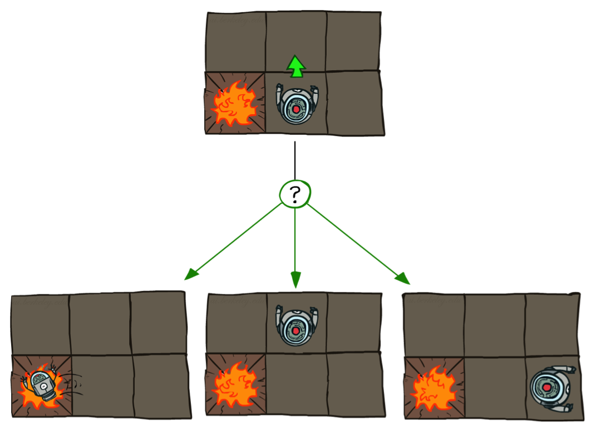
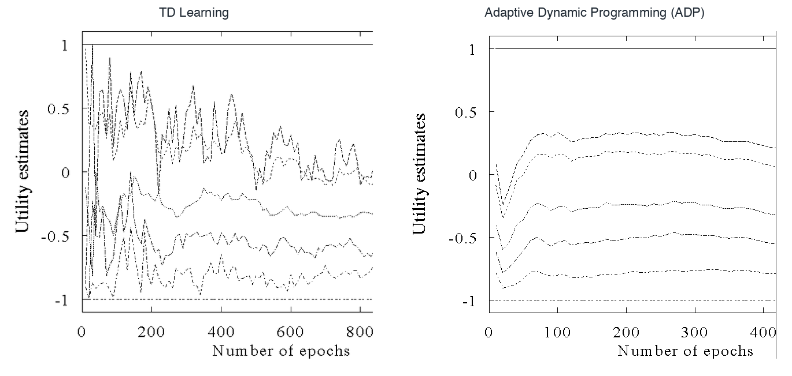

## Markov Decision Processes (MDPs)

::: {#def-ai-8-1 name="Markov Decision Process"}

Sequential decision model under stochastic dynamics: states $S$, actions $A$, transition $T(s,a,s') = P(s' \mid s,a)$, reward $R(s)$ (or $R(s,a,s')$), start state, and optional terminal states.

:::

- Assumptions: First-order Markov & stationary $T$, **full observability** ($s_t = f(o_t)$ observed after acting), and scalar rewards specifying *what* to achieve (dense shaping rewards learn faster than sparse rewards).
- Planning (known $T, R$) vs. reinforcement learning (unknown $T, R$, learned from $\langle s, a, r, s' \rangle$ samples).

{.notes-slide-fig width="58%" fig-align="center"}

### Policies and Bellman Equations

- Policy: Closed-loop map $\pi(s, t)$ (finite horizon, $t$ stages-to-go) or stationary $\pi: S \to A$ (infinite horizon).
- Discounted value ($0 \le \gamma < 1$, bounding cyclic sums and favoring earlier rewards):

  $$
  V^\pi(s) = \mathbb{E}\!\left[\sum_{t=0}^\infty \gamma^t R(S_t) \;\middle|\; S_0 = s, \pi\right] = R(s) + \gamma \sum_{s' \in S} T\bigl(s, \pi(s), s'\bigr) V^\pi(s').
  $$

- **Bellman optimality** (from the *Principle of Optimality*):

  $$
  V^*(s) = R(s) + \gamma \max_{a \in A} \sum_{s' \in S} T(s, a, s') V^*(s').
  $$

- Living-reward intuition (Grid World with $+1$ goal, $-1$ cliff): $R(s) = -2.0$ jumps into nearest exit (even $-1$); $-0.4$ risks the short cliff path; $-0.03$ detours safely; $-0.01$ faces into the wall so slips never hit $-1$.

## Value and Policy Iteration

### Value Iteration (VI)

Repeatedly apply $V_{k+1}(s) \leftarrow R(s) + \gamma \max_a \sum_{s'} T(s,a,s') V_k(s')$ from $V_0 = 0$:

::: {#thm-ai-8-1 name="Contraction and Greedy Bounds"}

1. $\gamma$-contraction: $\|V_{k+1} - V^*\|_\infty \le \gamma \|V_k - V^*\|_\infty \implies V_k \to V^*$ uniquely.
2. Stopping rule: $\|V_k - V_{k-1}\|_\infty \le \epsilon \implies \|V_k - V^*\|_\infty \le \dfrac{\epsilon\gamma}{1 - \gamma}$.
3. Greedy policy $\pi_g$ on $V_k$: $\|V_k - V^*\|_\infty \le \lambda \implies \|V^{\pi_g} - V^*\|_\infty \le \dfrac{2\lambda\gamma}{1 - \gamma}$ (exact $\pi_g = \pi^*$ below a finite $\lambda$).

:::

- Drawbacks of VI: $O(|S|^2|A|)$ per sweep; $\arg\max_a$ rarely changes, and $\pi_g$ converges long before $V_k$.

### Policy Iteration (PI) and DP Extensions

Policy Iteration alternates until $\pi' = \pi$ (monotonic $V^{\pi'} \ge V^\pi$; at most $|A|^{|S|}$ steps, empirically $O(|S|)$, worst-case polynomial bound open):

1. Evaluation: Solve $(I - \gamma T^\pi)V^\pi = R$ ($O(|S|^{2.373})$), or run $k$ iterative backups (**Modified PI**; GPI = any interleaving).
2. Improvement: $\pi'(s) = \arg\max_a \sum_{s'} T(s,a,s') V^\pi(s')$.

Scaling beyond full-width $O(|S|^2|A|)$ sweeps (**curse of dimensionality**):

- Asynchronous DP (individual state backups): In-place DP (1 table), Prioritized sweeping (max Bellman error via reverse dynamics), and Real-time DP (states visited along agent trajectories).
- Sample backups ($O(1)$ per $\langle s,a,r,s'\rangle$) & Fitted VI: Sample states $\{s^{(i)}\}$, compute Bellman targets $y^{(i)}$, and regress $\hat{v}(s, w)$ onto $y^{(i)}$.

## Passive Reinforcement Learning

Fix policy $\pi$ under unknown $(T, R)$ and estimate $V^\pi(s)$ from trajectory episodes:

| Method | Mechanism | Bellman | Cost | Sample Eff. |
| :--- | :--- | :--- | :--- | :--- |
| MC (model-free) | Average discounted reward-to-go | None | Low | Low |
| ADP (model-based) | Fit $\hat{T}, \hat{R}$, run full DP evaluation | Full | High | High |
| TD (model-free) | Bootstrap on observed $(s,a,r,s')$ | Partial | Low | Medium |

- **Temporal Difference (TD)** update (online running mean toward noisy target $R(s) + \gamma V^\pi(s')$, converging as $\alpha_n \propto 1/n$):

  $$
  V^\pi(s) \leftarrow V^\pi(s) + \alpha \Bigl(R(s) + \gamma V^\pi(s') - V^\pi(s)\Bigr).
  $$

- Bridging TD & ADP: Mix real TD updates with TD updates on "imagined" transitions sampled from $\hat{T}$—trading extra compute per step for higher sample efficiency (approaching ADP as imagined samples $\to \infty$).

{.notes-slide-fig width="90%" fig-align="center"}
